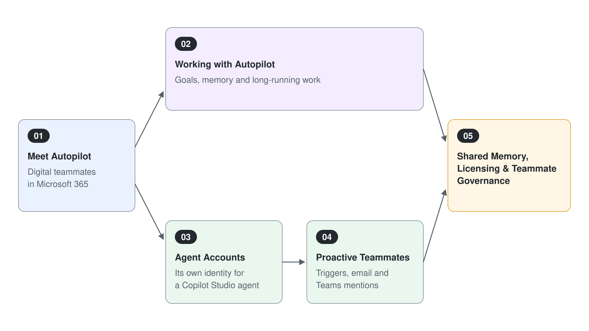

# AI Teammates: Autopilot & Agent Accounts

Cowork completes the work you hand it, and a Copilot Studio agent answers when someone asks. A teammate agent goes one step further: it holds its own identity in the tenant, remembers what the team tells it, and keeps a business process moving without waiting for a prompt. This module covers the two ways Microsoft 365 delivers that model today: Autopilot, the persistent personal agent announced on September 25, 2026, and agent accounts, which give a Copilot Studio agent its own Entra ID, mailbox, and Teams presence.

Both are Frontier previews. Autopilot is available to select eligible Frontier customers in the United States, optimized for English, and rolls out to new Frontier tenants over time; agent accounts need a Frontier-enrolled tenant, an early release environment, and dedicated per-agent licenses. Treat the module as a forward look you can run in a prepared tenant, and plan the prerequisites in [Run Autopilot](06-autopilot-admin/readme.md) and [Shared Memory, Licensing & Teammate Governance](05-memory-governance/readme.md) before the class starts.

## Topics

| # | Topic | What you learn |
|---|-------|----------------|
| 1 | [Meet Autopilot](01-meet-autopilot/readme.md) | What makes Autopilot a teammate, the four ways to work with Copilot, where you meet it, and what the tenant needs before anyone creates one |
| 2 | [Autopilot at Work](02-autopilot-at-work/readme.md) | The brief, routines, Activity, approvals, skills, plugins and browser use, and work with coworkers |
| 3 | [Agent Accounts: Give a Copilot Studio Agent Its Own Identity](03-agent-accounts/readme.md) | The maker flow from Agent account to Publish, what the account provisions, tool authentication, and the preview limitations |
| 4 | [Proactive Teammates: Triggers, Email & Teams Mentions](04-proactive-teammates/readme.md) | Email and schedule triggers on the Microsoft Copilot harness, @mentions in Teams, Outlook, and Office comments, and the Cadence execution-review agent |
| 5 | [Shared Memory, Licensing & Teammate Governance](05-memory-governance/readme.md) | How shared memory works and what it never keeps, the Frontier for AI Teammates license pool, admin activation, and Agent 365 controls |
| 6 | [Run Autopilot: Activation, Guardrails and Credits](06-autopilot-admin/readme.md) | Frontier enrollment, the activation wizard, spending policies, the model and its provider, content guardrails and memory |
| 7 | Place Autopilot in the Agent Landscape | Home, Chat, Cowork, Code and Autopilot, Copilot Studio agents with accounts, Foundry autopilots, and which request goes where |
| 8 | Read Approval Cards: How Autopilot Asks First | The automated review, the approval card and its reasons, approvals in routines, and earning trust step by step |
| 9 | Extend Autopilot with Skills, Plugins & Edge | Adding plugins, creating, uploading and sharing skills, and Autopilot in your own Microsoft Edge |
| 10 | Govern Autopilot Like an Employee: Identity & Security | The agent identity in Entra, Conditional Access coverage, the audit split, compliance gaps and the required security capabilities |

## How the Two Paths Relate

Autopilot is the ready-made teammate a user sets up in Copilot, and an agent account is the build path for a maker who needs control over instructions, tools, and triggers. Both end in the same place: an identity that admins govern like any other member of the organization.

## Duration & Audience

This module extends the four-day course for Power Platform makers, solution architects, and engineers who already built agents in [Module 3: Copilot Studio](../02-cs-basics/readme.md). Topics 1, 3, and 5 carry the core path; topics 2 and 4 deepen it for tenants with preview access. Topics 1, 2 and 6 to 10 form the Autopilot path on their own, for decision makers and architects who plan Autopilot for their organization.

## Prerequisites

- The Copilot Studio module, in particular Microsoft Copilot Harness Agents in Copilot Studio, because agent accounts and triggers run on the Microsoft Copilot harness
- A Microsoft 365 tenant enrolled in the Frontier program, with the admin steps in [topic 5](05-memory-governance/readme.md) completed before the class
- For agent accounts: an early release environment and a maker license (Microsoft 365 E5 with the Agent 365 add-on, or Microsoft 365 E7)

## Links & Resources

- [Introducing the new Copilot with Home, Code and Autopilot](https://blogs.microsoft.com/blog/2026/09/25/introducing-the-new-copilot-with-home-code-and-autopilot/)
- [Give your agent an account (Frontier)](https://learn.microsoft.com/microsoft-copilot-studio/agents-experience/authoring-agent-account)
- [FAQ for agent accounts (Frontier)](https://learn.microsoft.com/microsoft-copilot-studio/faq-agent-accounts)
- [Autopilot (Frontier) overview](https://learn.microsoft.com/copilot/autopilot/overview)
- [Configure Autopilot for your organization](https://learn.microsoft.com/copilot/autopilot/admin-configure)
- [Overview of Microsoft Agent 365](https://learn.microsoft.com/microsoft-agent-365/overview)
- [Preview Microsoft Agent 365 features through the Frontier program](https://learn.microsoft.com/microsoft-agent-365/frontier)
