# AI Teammates: Autopilot & Agent Accounts

Hands-on labs for [Module 8](../../demos/07-autopilot/readme.md). Every lab needs a tenant enrolled in the Frontier program with Autopilot activated and each learner covered by a spending policy that includes Autopilot. The labs for agent accounts are still a plan: each gets its full guide once it has been run end to end in a Frontier tenant with agent accounts activated.

| Lab | Deutsch | Focus | Minutes |
|-----|---------|-------|---------|
| [Create Your Autopilot](01-meet-autopilot/lab-01-create-your-autopilot.md) | | Name it, choose its starter routines and confirm the profile it inferred, plus 10 to 30 minutes of provisioning | 10 |
| [Brief, Schedule, Approve](02-autopilot-at-work/lab-01-brief-schedule-approve.md) | | Write the brief, add a scheduled and an event routine, and answer an approval, in pairs | 40 |
| [Autopilot Readiness Review](06-autopilot-admin/lab-01-autopilot-readiness-review.md) | | Check your Autopilot's owner, reach, routines, memory, approvals and credits | 15 |
| Test Your Autopilot's Boundaries | | Trigger three actions, read each card's reason and check that a mail authorizes nothing, in pairs | 25 |
| Build and Share a Skill | | Create, upload and share skills, and use the one your partner shared, in pairs | 30 |
| **Total** | | | **120** |

## Planned Labs for Agent Accounts

These labs need an early release environment, a maker license (Microsoft 365 E5 with the Agent 365 add-on, or Microsoft 365 E7), and a free Microsoft 365 Frontier for AI Teammates license per participant agent.

### Lab 3: Create the Cadence Agent with an Account

Topic: [Agent Accounts](../../demos/07-autopilot/03-agent-accounts/readme.md). About 30 minutes.

- Create a new agent in Copilot Studio Preview in the early release environment.
- Paste the Cadence instructions, add an account, and plan the display name and email address before you publish.
- Review the authentication mode of each tool.
- Publish and find Cadence in the Teams people picker and the directory.

### Lab 4: Make Cadence Proactive

Topic: [Proactive Teammates](../../demos/07-autopilot/04-proactive-teammates/readme.md). About 40 minutes.

- Create a workstream tracker in a SharePoint site that Cadence can read.
- Add a recurrence trigger and an email trigger.
- Run one review cycle and open the new review document.
- Contribute an update as a reviewer, once by email reply and once by @mention in Teams.

### Lab 5: Teammate Readiness Review

Topic: [Shared Memory, Licensing & Teammate Governance](../../demos/07-autopilot/05-memory-governance/readme.md). About 25 minutes.

- Walk the four admin activation steps and record who owns each one in your tenant.
- Check the Frontier for AI Teammates license pool before and after publishing.
- Tell Cadence a preference, a performance judgment, and a phone number, then list its shared memories and see which it kept.
- Delete one saved memory.
